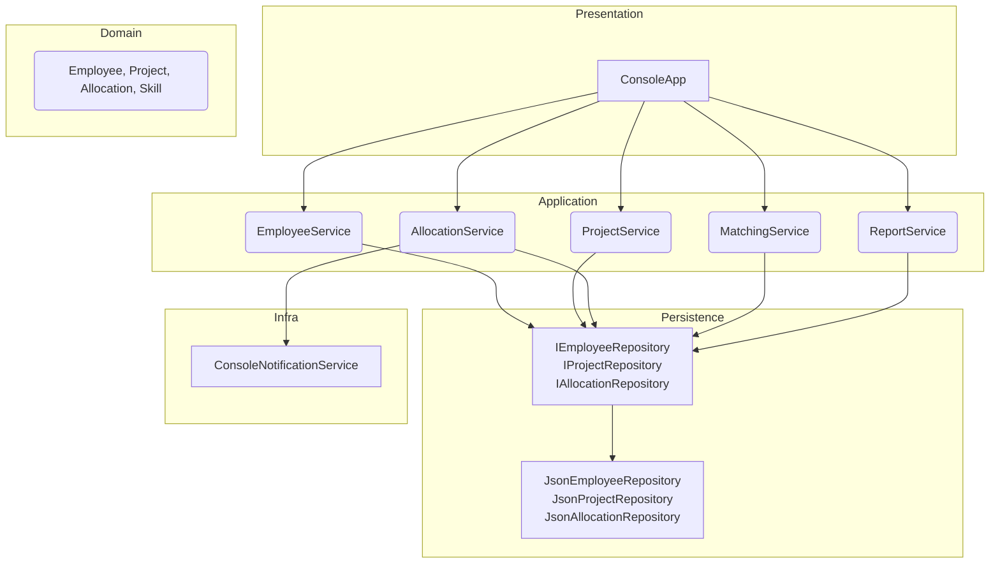
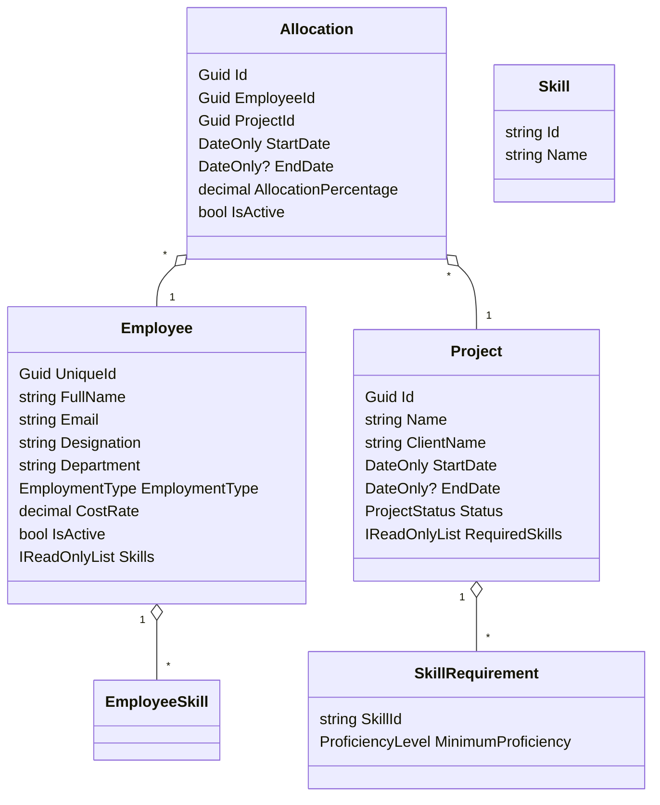

Design notes for TechNovaConsole RMS
===================================

This file documents architecture decisions, diagrams and rationale for the TechNovaConsole Resource Management System.

Architecture style
------------------
TechNovaConsole uses a layered architecture:
- Presentation: ConsoleApp (menus, prompts, formatting)
- Application services: EmployeeService, ProjectService, AllocationService, MatchingService, ReportService
- Domain: Models (Employee, Project, Allocation, Skill, SkillRequirement, enums)
- Persistence: Repository interfaces (IEmployeeRepository, IProjectRepository, IAllocationRepository) and JSON-backed implementations.

Rationale: layering separates concerns, keeps Program.cs as the composition root and places business rules inside services where they can be tested.

Mermaid architecture diagram
----------------------------

Mermaid domain/class diagram
---------------------------

Architecture Decision Records (ADRs)
-----------------------------------

ADR 1: Layered architecture and project organization
Context: Keep separation of concerns, allow unit testing of business rules, and keep console-specific code isolated.
Decision: Use layered architecture (presentation -> services -> domain -> repositories).
Alternatives: Monolithic single-file app, hexagonal architecture, microservices (overkill).
Consequences: Clear boundaries, easier testing, some duplication in DTOs may occur.

ADR 2: JSON file persistence behind repository interfaces
Context: No database allowed; persistence must survive restarts.
Decision: Implement repository interfaces and JSON-backed implementations using System.Text.Json, file-safe writes and in-memory caches.
Alternatives: SQLite, XML, in-memory only.
Consequences: Easy to inspect data files; not suitable for high concurrency or large datasets; migration path to EF Core is straightforward.

ADR 3: Allocation as an independent entity
Context: Allocations have lifecycle separate from employees and projects (release, historical reporting).
Decision: Model Allocation as an entity with its own Id and IsActive flag; do not cascade deletes.
Alternatives: Embed allocations inside employees/projects arrays in JSON; model allocations as transient assignments.
Consequences: Easier reporting and historical auditing; must ensure referential integrity across repositories.

ADR 4: Employment type represented by an enum rather than inheritance
Context: Employment types affect capacity and cost rate but do not require behavior differences currently.
Decision: Use an EmploymentType enum on Employee instead of subtype classes.
Alternatives: Use inheritance or strategy objects per employment type.
Consequences: Simpler model; when employment-type-specific behavior is required, add policy classes or replace enum with strategy.

ADR 5: Result<T> for expected business failures
Context: Many business rules produce validation-like failures that should not be thrown as exceptions.
Decision: Introduce Result and Result<T> to represent success/failure with error messages.
Alternatives: Use exceptions for flow control; return nulls.
Consequences: Clear contract for callers and presentation layer to display errors; must still throw for programmer errors.

ADR 6: Dependency injection and service lifetimes
Context: Console application with services and repositories; concurrency concerns for repositories.
Decision: Register JSON repositories as singletons (they coordinate writes with SemaphoreSlim), application services as singletons, ConsoleApp as transient, and the seeder as singleton.
Alternatives: Scoped lifetimes or transient repositories.
Consequences: Avoid injecting scoped services into singletons. Singletons are safe because repositories synchronize access.

ADR 7: Skill matching and availability algorithm
Context: Need deterministic, explainable candidate ranking for staffing.
Decision: Normalize skill ids; require minimum proficiency; compute per-day capacity using inclusive date ranges; score is 70% skills coverage + 30% capacity factor.
Alternatives: More complex machine-learning ranking; weighting permutations; fuzzy matching.
Consequences: Deterministic and explainable ranking; easy to reason about.

SOLID mapping
-------------
- Single Responsibility: Services (AllocationService, EmployeeService) each own one area of business rules.
- Open/Closed: MatchingService scoring can be extended by substituting a different scoring utility without changing caller code.
- Liskov Substitution: Repositories implement interfaces allowing substitution with in-memory or JSON implementations.
- Interface Segregation: Small repository interfaces for specific entities (IEmployeeRepository etc.).
- Dependency Inversion: High-level services depend on repository interfaces and INotificationService rather than concrete JSON classes.

Deliberate deviation from strict SOLID
-------------------------------------
- ConsoleNotificationService writes directly to Console for simplicity. Strictly speaking, this couples infrastructure to Console, but the INotificationService abstraction allows replacing it later.

Error handling strategy
-----------------------
- Validation and expected business failures return Result or Result<T> with errors. Exceptions are reserved for programmer or infrastructure failures.
- Repositories catch serialization or I/O exceptions and surface them as thrown exceptions; callers wrap operations with try/catch as appropriate.

Dependency injection composition root and lifetimes
-------------------------------------------------
- Program.cs builds HostApplicationBuilder and registers:
  - Json*Repository singletons (thread-safe with SemaphoreSlim)
  - EmployeeService, ProjectService, AllocationService, MatchingService, ReportService as singletons
  - ConsoleApp as transient
  - DeterministicSeeder as singleton

JSON persistence format, path resolution, write coordination and recovery policy
-------------------------------------------------------------------------------
- Format: simple arrays of objects. Employees contain skills as { name, proficiency } and project skill requirements as { skillId, minimumProficiency }.
- Path: App_Data under AppContext.BaseDirectory (application output directory). The project copies App_Data files to output during build.
- Coordination: repositories use SemaphoreSlim for synchronous access and write to temporary files then File.Replace to minimize corruption.
- Recovery: on filesystem write failures, repositories attempt fallback moves; malformed JSON may throw during load and developers should restore from backups.

Matching algorithm and allocation-capacity algorithm
--------------------------------------------------
- Matching: documented above in ADR 7.
- Capacity: AllocationValidator performs day-by-day inclusive checks and returns whether requested percentage can be accommodated. MaxAllocatedPercentage computes maximum sum across days for reports.

Employment type modeling rationale
---------------------------------
- EmploymentType enum is sufficient for the current scope. If different work-hour models are needed, introduce a capacity policy mapping for each employment type.

Testing strategy
----------------
- Unit tests use in-memory repository fakes to isolate services and avoid touching App_Data files.
- Tests cover allocation rules, matching and report calculations.
- Integration tests for JSON repositories can be added using temporary directories.

Future migration path
---------------------
- To migrate to ASP.NET Core MVC: keep services and repositories, add controllers and views; register repository implementations via DI; move ConsoleApp UI to web controllers.
- To migrate to EF Core: implement repository interfaces with EF Core DbContext and transactional guarantees, write migration scripts for JSON -> relational.
- To migrate to .NET MAUI: create a UI layer that calls the same application services; keep business rules in services so no duplication is needed.
